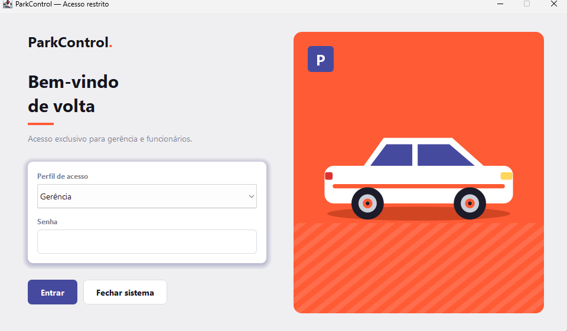
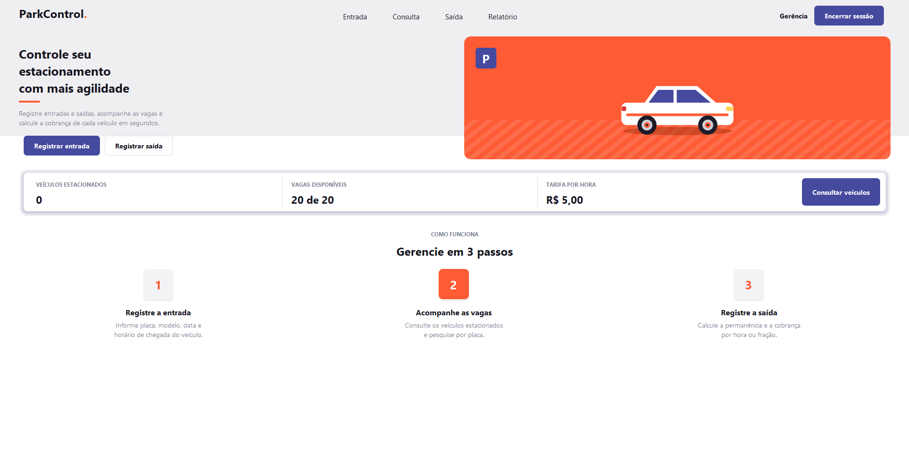
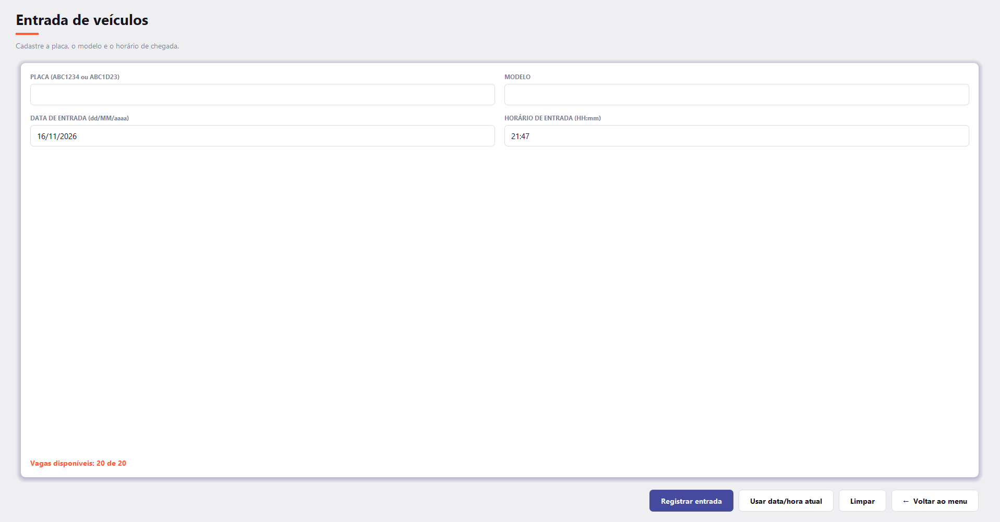
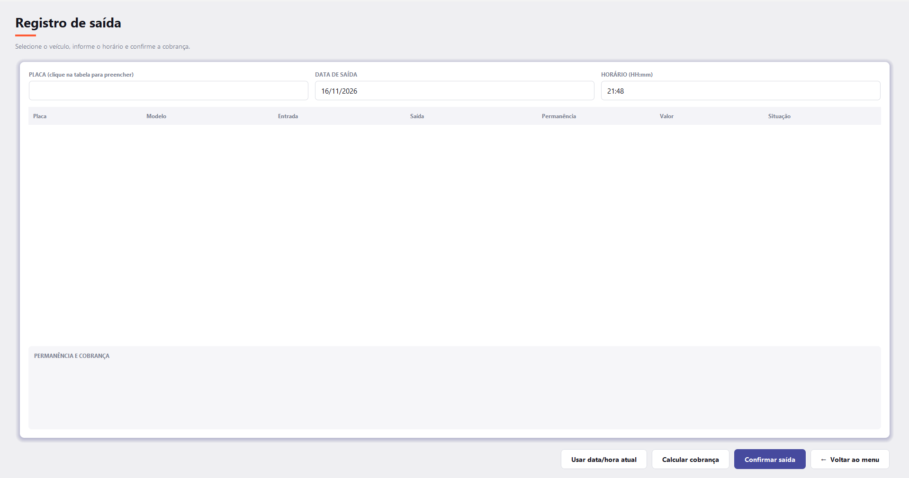
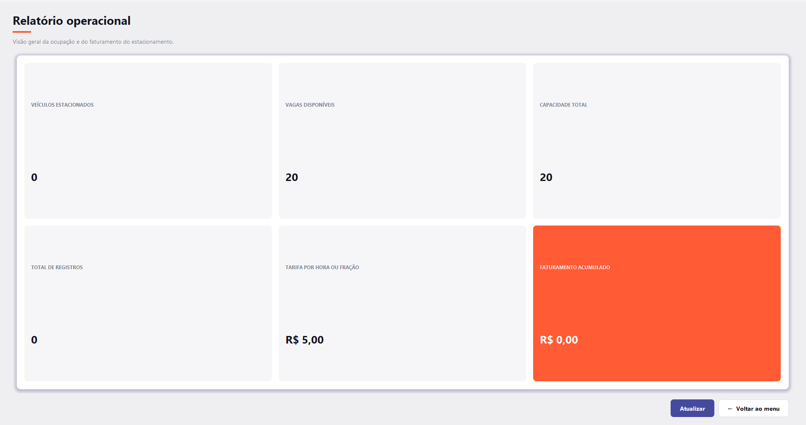

<div align="center">

# 🚗 ParkControl

### Sistema de Controle de Estacionamento

Controle de **entrada e saída de veículos**, **ocupação de vagas** e **cobrança por tempo de permanência**.


**Disciplina:** Iniciação à Programação  •  **Grupo 08**

[🖼️ Telas](#telas) • [🎬 Vídeo](#video) • [✨ Funcionalidades](#funcionalidades) • [🔐 Acesso](#acesso) • [🏗️ Arquitetura](#arquitetura) • [▶️ Como executar](#executar) • [🧪 Testes](#testes)

</div>

---

## 📌 Em resumo

| | |
|---|---|
| **O que é** | Aplicação desktop para gerenciar um estacionamento |
| **Quem usa** | Apenas **gerência** e **funcionários** (o cliente não acessa o sistema) |
| **Tecnologia** | Java SE puro + Java Swing |
| **Arquitetura** | MVC (`model`, `view`, `controller`) |
| **Armazenamento** | Somente em memória (`ArrayList`) |
| **Tarifa** | R$ 5,00 por hora ou fração |
| **Vagas** | 20 |
| **Demonstração** | [🎬 Assistir ao vídeo no YouTube](https://youtu.be/R_hIxrgFGwI?si=VdEksum9xui6Pkl1) |

---

## 👥 Integrantes

| Nome | Responsabilidade principal |
|---|---|
| Artur Moisés Moraes Sousa | Model e regras de negócio (`Veiculo`, `Estacionamento`) |
| Gabriel Henrique da Silva Brandão | Controller e validações (`EstacionamentoController`) |
| Guilherme Araujo Silva | Telas de entrada e consulta (`TelaEntrada`, `TelaConsulta`) |
| João Pedro Gonsalves de Aquino | Tela de saída e cálculo de cobrança (`TelaSaida`) |
| João Victor Carvalho de Faris | Tela principal, login e tema visual (`TelaPrincipal`, `TelaLogin`, `Tema`) |
| Vinicius Medeiros de Carvalho Santos | Relatório operacional, testes e documentação (`TelaRelatorio`, README) |

---

<a id="telas"></a>

## 🖼️ Telas do sistema

> 💡 Clique em qualquer imagem para abri-la em tamanho original.

### 1️⃣ Login

Acesso restrito: o usuário escolhe o perfil (**Gerência** ou **Funcionário**) e digita a senha.

<p align="center">
  <a href="docs/01-login.png"></a>
</p>

<br>

### 2️⃣ Tela principal

Menu de navegação no topo, resumo da ocupação (veículos estacionados, vagas disponíveis e tarifa) e atalhos para as principais operações.

<p align="center">
  <a href="docs/02-tela-principal.png"></a>
</p>

<br>

### 3️⃣ Entrada de veículos

Cadastro de **placa, modelo, data e horário de entrada**, com contador de vagas disponíveis.

<p align="center">
  <a href="docs/03-entrada.png"></a>
</p>

<br>

### 4️⃣ Registro de saída

Selecione o veículo na tabela, informe o horário de saída, veja a **permanência e o valor a pagar** e confirme.

<p align="center">
  <a href="docs/04-saida.png"></a>
</p>

<br>

### 5️⃣ Relatório operacional

Disponível **somente para a gerência**: veículos estacionados, vagas, capacidade, total de registros, tarifa e **faturamento acumulado**.

<p align="center">
  <a href="docs/05-relatorio.png"></a>
</p>

---

<a id="video"></a>

## 🎬 Vídeo de demonstração

Assista ao sistema funcionando: login, cadastro de entrada, consulta, registro de saída com cálculo da cobrança e relatório da gerência.

<p align="center">
  <a href="https://youtu.be/R_hIxrgFGwI?si=VdEksum9xui6Pkl1" title="Assistir no YouTube">
    
  </a>
</p>

<p align="center">
  <a href="https://youtu.be/R_hIxrgFGwI?si=VdEksum9xui6Pkl1">
    
  </a>
</p>

> 💡 Clique na imagem ou no botão vermelho para abrir o vídeo no YouTube.

### O que é mostrado no vídeo

| Etapa | O que acontece |
|:-:|---|
| 1 | 🔐 **Login** com os perfis de Funcionário e de Gerência |
| 2 | 🚙 **Registro de entrada** de veículos (placa, modelo, data e horário) |
| 3 | ⚠️ **Validações** funcionando (placa inválida, placa duplicada, data inválida) |
| 4 | 🔎 **Consulta** de veículos estacionados e pesquisa por placa |
| 5 | 🚪 **Registro de saída** com cálculo de permanência e cobrança |
| 6 | 📊 **Relatório operacional** com o faturamento acumulado (somente gerência) |

<details>
<summary><b>🔗 Link direto do vídeo</b></summary>

<br>

https://youtu.be/R_hIxrgFGwI?si=VdEksum9xui6Pkl1

</details>

---

## 📑 Sumário

1. [Funcionalidades](#funcionalidades)
2. [Acesso ao sistema](#acesso)
3. [Regras de negócio](#regras)
4. [Arquitetura (MVC)](#arquitetura)
5. [Estrutura do projeto](#estrutura)
6. [Componentes Swing utilizados](#swing)
7. [Requisitos do trabalho × atendimento](#requisitos)
8. [Como executar](#executar)
9. [Como usar o sistema](#uso)
10. [Roteiro de testes](#testes)
11. [Como personalizar](#personalizar)
12. [Limitações e melhorias](#limitacoes)
13. [Tecnologias](#tecnologias)

---

<a id="funcionalidades"></a>

## ✨ 1. Funcionalidades

### Funcionalidades do tema (obrigatórias)

| Nº | Funcionalidade | Descrição | Tela |
|:-:|---|---|---|
| 1 | 🚙 **Registro de entrada** | Cadastra placa, modelo, data e horário de entrada | Entrada |
| 2 | 📋 **Listagem de veículos** | Exibe os veículos estacionados em uma `JTable` | Consulta |
| 3 | 🔎 **Pesquisa por placa** | Localiza veículos (placa inteira ou parte dela) e mostra a situação: *Estacionado* ou *Saiu* | Consulta |
| 4 | 🚪 **Registro de saída** | Informa data e horário de saída e encerra a permanência | Saída |
| 5 | ⏱️ **Cálculo de permanência** | Calcula o tempo total estacionado, em horas e minutos | Saída |
| 6 | 💰 **Cálculo de cobrança** | Valor devido: **R$ 5,00 por hora ou fração**, mínimo de 1 hora | Saída |
| 7 | 📊 **Relatório operacional** | Veículos estacionados, vagas disponíveis e faturamento acumulado | Relatório |

### Extras implementados

- 🔐 **Login com dois perfis** (Gerência e Funcionário), pois o sistema é de uso interno.
- 🛡️ **Relatório restrito à gerência**, porque exibe o faturamento.
- 👀 **Prévia da cobrança** antes de confirmar a saída.
- 🖱️ **Seleção do veículo pela tabela** na tela de saída (clique na linha e a placa é preenchida).
- 🕒 Botão **"Usar data/hora atual"** nos formulários.
- 📈 **Resumo na tela principal** com ocupação e tarifa.

---

<a id="acesso"></a>

## 🔐 2. Acesso ao sistema

| Perfil | Senha | Permissões |
|---|---|---|
| 👔 **Gerência** | `gerente123` | Entrada, consulta, saída e **relatório operacional** |
| 🧑‍💼 **Funcionário** | `func123` | Entrada, consulta e saída (**relatório bloqueado**) |

As senhas ficam em `src/model/Perfil.java` e podem ser alteradas.

> [!NOTE]
> As senhas são fixas no código porque o trabalho não permite banco de dados nem armazenamento externo. Em um sistema real, elas ficariam criptografadas em um banco.

---

<a id="regras"></a>

## 📏 3. Regras de negócio

### Cobrança

O tempo é arredondado **para cima**, em horas inteiras, e o mínimo cobrado é de **1 hora**.

| Permanência | Horas cobradas | Valor |
|:-:|:-:|:-:|
| 10 min | 1 | R$ 5,00 |
| 1h 00min | 1 | R$ 5,00 |
| 1h 01min | 2 | R$ 10,00 |
| 2h 10min | 3 | R$ 15,00 |

### Validações

| Situação | Resultado |
|---|---|
| Placa fora do padrão (`ABC1234` ou `ABC1D23`) | ❌ Erro de placa inválida |
| Modelo vazio | ❌ Erro |
| Data ou hora inválida (ex.: `31/02/2026`) | ❌ Erro |
| Entrada de placa que já está estacionada | ❌ Erro de duplicidade |
| Entrada com o estacionamento lotado (20 vagas) | ❌ Erro de lotação |
| Saída de veículo que não está estacionado | ❌ Erro |
| Saída anterior ao horário de entrada | ❌ Erro |

- **Placas:** letras minúsculas, espaços e hífen são normalizados (`abc-1234` vira `ABC1234`).
- **Faturamento:** soma dos valores cobrados em todas as saídas confirmadas.

---

<a id="arquitetura"></a>

## 🏗️ 4. Arquitetura (MVC)

```
┌──────────┐   eventos    ┌──────────────┐   operações   ┌───────────┐
│   VIEW   │ ───────────► │  CONTROLLER  │ ────────────► │   MODEL   │
│  (Swing) │ ◄─────────── │              │ ◄──────────── │ (regras + │
└──────────┘  dados/erros └──────────────┘   resultados  │ ArrayList)│
                                                          └───────────┘
```

| Camada | Responsabilidade | Classes |
|---|---|---|
| 🗃️ **Model** | Dados e regras de negócio: classes Java, cálculos e coleção em memória | `Veiculo`, `Estacionamento`, `Perfil` |
| 🖥️ **View** | Telas Swing: exibe informações e recebe as ações do usuário. **Sem regra de negócio** | `TelaLogin`, `TelaPrincipal`, `TelaEntrada`, `TelaConsulta`, `TelaSaida`, `TelaRelatorio`, `TelaBase`, `TabelaVeiculos`, `Tema`, `PainelHero` |
| 🎛️ **Controller** | Recebe os eventos, valida e converte os dados digitados e chama o Model | `EstacionamentoController` |

### Exemplo de fluxo: registrar uma entrada

1. O usuário preenche o formulário em `TelaEntrada` e clica em **Registrar entrada**.
2. A View chama `controller.registrarEntrada(placa, modelo, data, hora)`.
3. O Controller normaliza a placa, valida o formato, converte data e hora e chama `estacionamento.registrarEntrada(...)`.
4. O Model aplica as regras (placa duplicada, vagas) e grava o `Veiculo` no `ArrayList`.
5. Se algo estiver errado, uma `IllegalArgumentException` sobe até a View, que mostra a mensagem em um `JOptionPane`.

<details>
<summary><b>📚 Ver a descrição de cada classe</b></summary>

<br>

**Model**

| Classe | Descrição |
|---|---|
| `Perfil` | `enum` com os perfis de acesso (Gerência e Funcionário) e suas senhas. |
| `Veiculo` | Dados de um veículo: placa, modelo, entrada, saída e valor cobrado. Informa se ainda está estacionado. |
| `Estacionamento` | Guarda os veículos em um `ArrayList` e implementa cadastrar, localizar, listar, calcular permanência, calcular valor e registrar saída. Mantém o faturamento acumulado. |

**Controller**

| Classe | Descrição |
|---|---|
| `EstacionamentoController` | Autenticação e perfil logado, validação da placa, conversão de data e hora (`dd/MM/aaaa HH:mm`), montagem dos resumos e das linhas da tabela, formatação de moeda e duração. |

**View**

| Classe | Descrição |
|---|---|
| `TelaLogin` | Tela de acesso (perfil e senha). |
| `TelaPrincipal` | Menu de navegação, resumo da ocupação e atalhos para as demais telas. |
| `TelaEntrada` | Formulário de registro de entrada. |
| `TelaConsulta` | Pesquisa por placa e listagem em `JTable`, com filtro (`JComboBox`). |
| `TelaSaida` | Registro de saída com prévia de permanência e cobrança. |
| `TelaRelatorio` | Indicadores operacionais e faturamento (somente gerência). |
| `TelaBase` | Classe base das telas internas: layout padrão e retorno ao menu. |
| `TabelaVeiculos` | `JTable` estilizada, reutilizada nas telas de consulta e saída. |
| `Tema` | Paleta de cores, fontes e componentes visuais (botão e cartão arredondados, campos). |
| `PainelHero` | Cartão laranja com o carro desenhado em Java2D. |

</details>

---

<a id="estrutura"></a>

## 📁 5. Estrutura do projeto

```
EstacionamentoGrupo08
├── README.md
├── .gitignore
├── docs
│   ├── 01-login.png
│   ├── 02-tela-principal.png
│   ├── 03-entrada.png
│   ├── 04-saida.png
│   └── 05-relatorio.png
└── src
    ├── Main.java
    ├── model
    │   ├── Perfil.java
    │   ├── Veiculo.java
    │   └── Estacionamento.java
    ├── controller
    │   └── EstacionamentoController.java
    └── view
        ├── Tema.java
        ├── PainelHero.java
        ├── TelaBase.java
        ├── TabelaVeiculos.java
        ├── TelaLogin.java
        ├── TelaPrincipal.java
        ├── TelaEntrada.java
        ├── TelaConsulta.java
        ├── TelaSaida.java
        └── TelaRelatorio.java
```

---

<a id="swing"></a>

## 🧩 6. Componentes Swing utilizados

`JFrame` • `JPanel` • `JLabel` • `JTextField` • `JPasswordField` • `JButton` • `JComboBox` • `JTable` • `JScrollPane` • `JTextArea` • `JOptionPane`

Além de **`Graphics2D` (Java2D)** para o visual personalizado (botões e cartões arredondados, sombras e a ilustração do carro).

---

<a id="requisitos"></a>

## ✅ 7. Requisitos do trabalho × atendimento

| Requisito | Atendimento |
|---|---|
| Arquitetura MVC | ✅ Pacotes `model`, `view` e `controller` |
| Interface exclusivamente em Java Swing | ✅ Todas as telas em Swing/Java2D |
| Tela principal com nome do sistema e navegação | ✅ `TelaPrincipal` |
| Formulários com `JTextField`, `JComboBox` e `JButton` | ✅ `TelaEntrada`, `TelaConsulta`, `TelaSaida` |
| Tabelas `JTable` | ✅ `TabelaVeiculos` |
| Mensagens de confirmação e erro com `JOptionPane` | ✅ Todas as telas |
| Validações para impedir dados incorretos | ✅ `EstacionamentoController` e `Estacionamento` |
| Navegação com retorno à janela principal | ✅ Botão "Voltar ao menu" e fechar a janela |
| Armazenamento em memória (`ArrayList`) | ✅ `Estacionamento.veiculos` |
| Dados disponíveis ao fechar e reabrir janelas | ✅ Um único `Estacionamento` vive durante toda a execução |
| Sem banco de dados, web, JavaFX ou frameworks externos | ✅ Apenas a biblioteca padrão do Java |
| Sete funcionalidades do tema | ✅ Ver seção 1 |

---

<a id="executar"></a>

## ▶️ 8. Como executar

### Pré-requisitos

- ☕ **JDK 11 ou superior**
- 🧰 **Eclipse IDE for Java Developers** (ou outra IDE Java)

### Opção A — Clonar do GitHub e abrir no Eclipse

```bash
git clone https://github.com/SEU-USUARIO/NOME-DO-REPOSITORIO.git
```

1. No Eclipse, vá em **File > New > Java Project**, dê o nome `EstacionamentoGrupo08` e **desmarque** *Create module-info.java*.
2. Copie a pasta `src` do repositório clonado para dentro do projeto (substituindo a `src` vazia) e atualize com **F5**.
3. Clique com o botão direito no projeto, escolha **Properties > Resource** e defina **Text file encoding** como **UTF-8**.
4. Clique com o botão direito em `Main.java` e escolha **Run As > Java Application**.

<details>
<summary><b>🛠️ Opção B — Montar o projeto do zero no Eclipse</b></summary>

<br>

1. **File > New > Java Project**, nome `EstacionamentoGrupo08`. Desmarque *Create module-info.java*.
2. Defina o encoding **UTF-8** em **Properties > Resource**.
3. Crie os pacotes `model`, `controller` e `view` dentro de `src`.
4. Crie cada classe no pacote indicado na seção 5 e cole o código correspondente.
5. Salve tudo com **File > Save All** (Ctrl+Shift+S).
6. Clique com o botão direito em `Main.java` e escolha **Run As > Java Application**.

</details>

<details>
<summary><b>💻 Opção C — Compilar e executar pelo terminal</b></summary>

<br>

Na raiz do repositório:

```bash
# Linux / macOS
mkdir -p out
javac -encoding UTF-8 -d out $(find src -name "*.java")
java -cp out Main
```

```bat
:: Windows (cmd)
dir /s /b src\*.java > fontes.txt
javac -encoding UTF-8 -d out @fontes.txt
java -cp out Main
```

</details>

<details>
<summary><b>🧯 Problemas comuns e soluções</b></summary>

<br>

| Mensagem ou sintoma | Solução |
|---|---|
| `declared package does not match` | Arraste a classe para o pacote correto no Package Explorer. |
| `X cannot be resolved to a type` | Falta criar ou salvar alguma classe. Crie a que falta e use Ctrl+Shift+O. |
| Acentos quebrados (`ç`) | Defina o encoding UTF-8 e cole o código novamente. |
| Erro mencionando `module java.desktop` | Apague o arquivo `module-info.java` do projeto. |

</details>

---

<a id="uso"></a>

## 🧭 9. Como usar o sistema

| Passo | Ação | Como fazer |
|:-:|---|---|
| 1 | **Entrar** | Escolha o perfil, digite a senha e clique em **Entrar** (ou pressione Enter) |
| 2 | **Registrar entrada** | Menu **Entrada** → informe placa, modelo, data e horário (ou use *Usar data/hora atual*) → **Registrar entrada** |
| 3 | **Consultar veículos** | Menu **Consulta** → veja os estacionados, troque o filtro para *Todos os registros* ou pesquise por placa |
| 4 | **Registrar saída** | Menu **Saída** → clique no veículo na tabela → informe data e horário → **Calcular cobrança** → **Confirmar saída** |
| 5 | **Ver o relatório** | Menu **Relatório** (somente gerência) → use **Atualizar** para recarregar |
| 6 | **Sair** | Botão **Encerrar sessão**, no canto superior direito |

📝 **Formatos aceitos:** data `dd/MM/aaaa` (ex.: `25/11/2026`) e hora `HH:mm` (ex.: `14:30`).

---

<a id="testes"></a>

## 🧪 10. Roteiro de testes

<details>
<summary><b>📋 Ver os 13 casos de teste</b></summary>

<br>

| Nº | Ação | Resultado esperado |
|:-:|---|---|
| 1 | Entrar como **Funcionário** (`func123`) | Menu abre com o **Relatório bloqueado** |
| 2 | Registrar `ABC1D23`, modelo "Gol" | Mensagem de sucesso; vagas disponíveis diminuem em 1 |
| 3 | Registrar `ABC1D23` novamente | Erro de placa já estacionada |
| 4 | Registrar placa `12345` | Erro de placa inválida |
| 5 | Registrar com data `31/02/2026` | Erro de data inválida |
| 6 | Consulta: pesquisar `ABC` | Veículo aparece com situação **Estacionado** |
| 7 | Saída com horário **anterior** à entrada | Erro: saída anterior à entrada |
| 8 | Saída 2h10min após a entrada, **Calcular cobrança** | Permanência `2h 10min` e valor **R$ 15,00** |
| 9 | Confirmar a saída | Veículo sai da lista de estacionados; situação passa a **Saiu** |
| 10 | Encerrar sessão e entrar como **Gerência** (`gerente123`) | Relatório liberado |
| 11 | Abrir o relatório | Faturamento acumulado de **R$ 15,00** |
| 12 | Fechar e reabrir uma tela | Os dados continuam disponíveis |
| 13 | Registrar 21 veículos diferentes | Erro de estacionamento lotado no 21º |

</details>

---

<a id="personalizar"></a>

## 🎨 11. Como personalizar

| O que mudar | Onde |
|---|---|
| 💵 Valor da tarifa | `Estacionamento.TARIFA_POR_HORA` |
| 🅿️ Número de vagas | `Estacionamento.CAPACIDADE` |
| 🧮 Regra de cobrança | método `calcularValor()` em `Estacionamento.java` |
| 🔑 Senhas dos perfis | `Perfil.java` |
| 🎨 Cores do sistema | constantes no topo de `Tema.java` |
| 🏷️ Nome da marca | método `logo()` em `Tema.java` |

---

<a id="limitacoes"></a>

## ⚠️ 12. Limitações e melhorias

### Limitações conhecidas

- Os dados ficam **somente em memória**: ao fechar a aplicação, tudo é perdido (conforme a especificação do trabalho).
- Os horários são digitados manualmente, com o botão de data/hora atual como atalho.
- A capacidade e a tarifa são constantes no código, sem tela de configuração.
- As senhas são fixas no código.

### Possíveis melhorias futuras

- 💾 Persistência em arquivo ou banco de dados.
- ⚙️ Tela de configuração de tarifa e capacidade.
- 🏍️ Tarifas diferentes por tipo de veículo (carro e moto).
- 🧾 Emissão de comprovante de saída.
- 🔒 Cadastro de usuários com senha criptografada.

---

<a id="tecnologias"></a>

## 🛠️ 13. Tecnologias

- ☕ Java SE (JDK 11 ou superior)
- 🖼️ Java Swing e Java2D
- 🏗️ Arquitetura MVC
- 📦 `ArrayList` para armazenamento em memória
- 🧰 Eclipse IDE

---

<div align="center">

**ParkControl** • Grupo 08 • Iniciação à Programação

🎬 [Assistir à demonstração no YouTube](https://youtu.be/R_hIxrgFGwI?si=VdEksum9xui6Pkl1)

Feito com ☕ e Java Swing

</div>
